<div align="center">
  
</div>

# ⛏️ SYMBIOMINE — Industrial Safety & Spatial Intelligence Ecosystem

### Offline-First Augmented Reality Safety Training for Mining Workers & Web-Based Safety Operations Command Center

[](https://developer.android.com)
[](https://kotlinlang.org)
[](https://unity.com)
[](https://react.dev)
[](https://www.typescriptlang.org)
[](https://vitejs.dev)
[](https://ai.google.dev)
[](https://ai.studio/apps/9dfcc5db-374f-4d07-b8e2-ccc79f8d8c80)
[](#)

---

## 🗂️ Platform Navigation

| Platform Module | Technology Stack | Location | Description |
| :--- | :--- | :--- | :--- |
| **SYMBIOMINE AR Mobile App** | Kotlin 2.2, Jetpack Compose, Unity AR, Room SQLite | [`app/`](app/) | Offline-first 3D AR spatial hazard drills, biometric login, visual MCQ exams, on-device QR certs. |
| **SymbioMine Admin Dashboard** | React 19, TypeScript 7, Vite 8, Express, Gemini AI, MCP | [`SymbioMine-Dashboard/`](SymbioMine-Dashboard/) | Surface command center, workforce roster, competency analytics, QR cert scanner, Agentic AI assistant. |
| **System Architecture & Specs** | Cross-platform architectural diagrams & API contracts | [`docs/architecture.md`](docs/architecture.md) | Canonical REST synchronization schemas, security boundaries, and deterministic safety rules. |

---

<p align="center">
  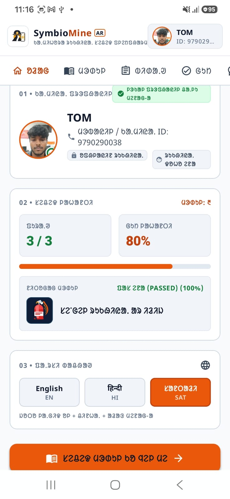
  <br>
  <em>Worker Safety Dashboard — Featuring localized Ol Chiki (Santali) typography, module completion tracking, and competency scores.</em>
</p>

---

## Project Overview

**SYMBIOMINE** is a comprehensive occupational safety ecosystem engineered for underground mining operations and hazardous industrial environments. The platform addresses the full continuum of industrial safety:

1. **Underground Field Operations (`app/`)**: The **SYMBIOMINE AR** native Android application provides hands-on Augmented Reality drills directly on workers' mobile devices in zero-connectivity subterranean stopes. Trainees interact with virtual 3D equipment, master emergency procedures, complete visual MCQ assessments, and receive tamper-evident digital certificates.
2. **Surface Operations & Compliance (`SymbioMine-Dashboard/`)**: The **SymbioMine Admin Dashboard** provides safety directors, training supervisors, and compliance officers with high-assurance operational intelligence, real-time competency analytics, certification verification, and an Agentic AI safety assistant with Model Context Protocol (MCP) tool execution.

---

## Problem

Underground mining environments present severe occupational hazards where split-second safety decisions prevent fatalities. However, conventional industrial safety education faces critical shortcomings:

* **Theory-Heavy Instruction**: Training is largely restricted to manuals and passive slide presentations, leaving workers unprepared for real physical emergencies.
* **Inability to Recreate Disasters Safely**: Real-world hazards—such as methane gas surges, electrical arc flashes, or conveyor belt fires—cannot be safely simulated in live mines without genuine danger.
* **No Underground Connectivity**: Mining stopes and remote shafts operate hundreds of meters underground with zero cellular or Wi-Fi connectivity, rendering cloud-dependent applications unusable.
* **Linguistic Diversity**: Frontline workforces speak regional languages (such as Hindi and Santali) and often encounter literacy hurdles with standard English technical manuals.
* **Disconnected Administration**: Safety supervisors lack real-time visibility into workforce training currency, credential expiries, and empirical hazard competency gaps.

---

## Solution

SYMBIOMINE bridges the gap between field reality and safety governance through immersive spatial computing and intelligent administration:

$$\text{Learn} \longrightarrow \text{Visualize} \longrightarrow \text{Interact} \longrightarrow \text{Practice} \longrightarrow \text{Assess} \longrightarrow \text{Certify} \longrightarrow \text{Analyze}$$

* **Practical 3D AR Drills**: Workers physically rehearse critical protocols—operating extinguisher valves, donning respirators, locking out gas mains, and verifying electrical de-energization.
* **Multilingual Accessibility**: Complete UI and spoken voice guidance localized in English, Hindi, and Santali (*Ol Chiki* script).
* **On-Device Biometric Accountability**: Facial recognition ensures the enrolled trainee actively completes their own training and assessment without proxy attendance.
* **Instant Competency Certification**: Verifiable digital certificates featuring offline-scannable QR codes are generated directly on the device upon scoring 80% or higher.
* **Centralized Safety Intelligence**: The web dashboard aggregates workforce performance, tracks remediation queues, audits security events, and provides AI-guided safety recommendations under strict human approval.

---

## Key Features

| Feature | Subsystem | Description | Implementation Status |
| :--- | :--- | :--- | :--- |
| **AR Safety Drills** | Mobile (`app`) | Spatial 3D simulations for fire suppression, gas leaks, and electrical safety | Verified (`Unity AR / ARCore`) |
| **Multilingual UI & Audio** | Mobile (`app`) | Full interface and audio narration in English, Hindi, and Santali (*Ol Chiki*) | Verified (`SantaliAudioEngine` / Noto Fonts) |
| **Local Biometric Auth** | Mobile (`app`) | On-device face scan matching to prevent proxy attendance | Verified (`CameraX` / Local Embeddings) |
| **Visual Scenario MCQs** | Mobile (`app`) | 10 module-specific visual questions with 3D diagram references | Verified (`Room DB` / Local Quiz Engine) |
| **Tamper-Evident Certificates** | Mobile (`app`) | Instant digital certificate with candidate metadata and offline verification QR | Verified (`BitmapUtil` / `QrCodeUtil`) |
| **100% Offline Runtimes** | Mobile (`app`) | Fully standalone operation with local SQLite storage and bundled APK modules | Verified (No cloud dependency) |
| **Operations Command Center** | Dashboard | Real-time KPI monitors for workforce readiness, safety scores, and alerts | Verified (React 19 / TypeScript 7) |
| **Competency Intelligence** | Dashboard | Gap analysis, domain breakdown, and cohort performance distribution | Verified (Custom Trend & Area Charts) |
| **QR Certificate Scanner** | Dashboard | Live optical camera feed & cryptographic payload verification portal | Verified (`jsqr` / `cryptoService`) |
| **Agentic AI Safety Assistant** | Dashboard | Gemini 3.8 Flash AI with controlled MCP tool execution and grounded citations | Verified (`@google/genai` / `agentEngine`) |
| **Deterministic Guardrails** | Dashboard | Non-LLM rule engine strictly enforcing DGMS safety criteria and pass boundaries | Verified (`safetyPolicy.ts`) |
| **Role-Based Access Control** | Dashboard | Granular permissions for Super Admin, Safety Manager, Supervisor, and Auditor | Verified (`rbacPolicy.ts`) |

---

## How It Works

1. **Worker Authentication**: The candidate logs in on the Android tablet using on-device facial biometric scanning or a 4-digit safety PIN.
2. **Curriculum Selection**: The worker navigates the mobile dashboard and selects an assigned safety competency module.
3. **Interactive AR Drill**: Tapping **"Launch AR"** starts the targeted Unity AR simulation. The worker interacts with virtual 3D equipment in physical space.
4. **Competency Assessment**: The worker completes a 10-question visual MCQ exam with localized audio playback.
5. **Score & Certification**: Upon achieving the 80% passing threshold, the application generates a signed safety certificate with an offline-verifiable QR code.
6. **Supervisory Verification**: Safety inspectors scan the physical or digital certificate QR code using the Admin Dashboard QR scanner for instant verification.
7. **Intelligence & Remediation**: Safety managers review cohort competency trends on the dashboard and dispatch targeted remediation packages to workers needing additional drills.

---

## System Architecture

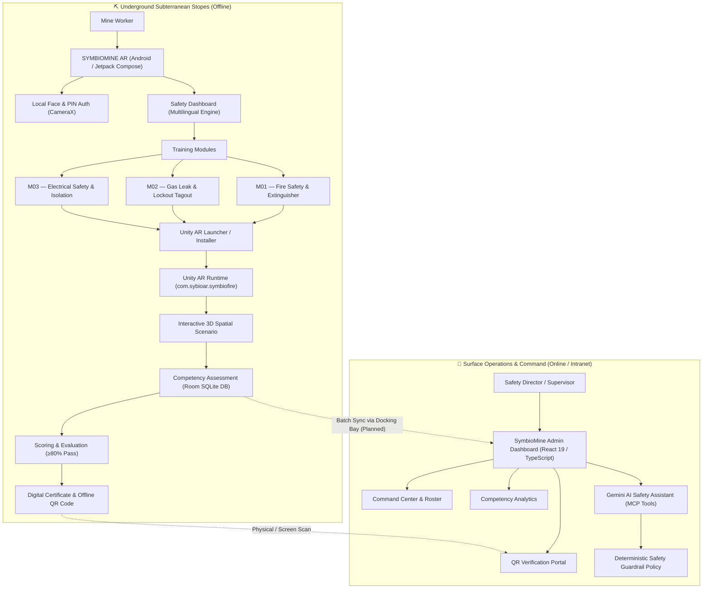

---

## Application Flow

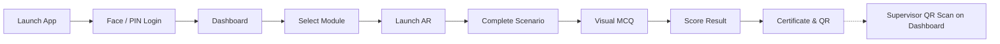

---

## AR Training Architecture

```
Android Host Application (Jetpack Compose)
       │  (Intent with module extras & target scene)
       ▼
Unity AR Module Runtime (ARCore Subsystem)
       │  (Hardware Camera feed + Surface tracking)
       ▼
Spatial Coordinate Anchor & 3D Hazard Meshes
       │  (Physical proximity checks & bounding collision)
       ▼
Step-by-Step Task Validation (PASS / LOTO / SCSR)
       │  (Scenario complete flag)
       ▼
Return to Android Host → Competency Assessment Flow
```

The AR experience interfaces with Android via explicit intents passing the candidate identifier, module ID, and target scene parameter (`scene = "GASLEACKAGE"` for Gas Leakage & LOTO, or `scene = "a"` for Fire Safety).

---

## AR Training Modules

### 🔥 Fire Safety & Extinguisher (Module 01)
* **Training Objective**: Master the standard **PASS** protocol (Pull, Aim, Squeeze, Sweep) and maintain safe standoff distances during high-heat underground fires.
* **Visible Scenario**: Conveyor drive motor fire in an underground belt drift.
* **Worker Interaction**: Trainees pull the safety pin, align the nozzle to the fire base, and sweep the retardant stream while staying within the **2.5m – 3.0m safe zone**. Approaching too close triggers immediate proximity warning HUD alarms.
* **Learning Outcome**: Instinctive reaction to industrial fires without panic or hazardous heat exposure.

<table>
  <tr>
    <td align="center" width="33%">
      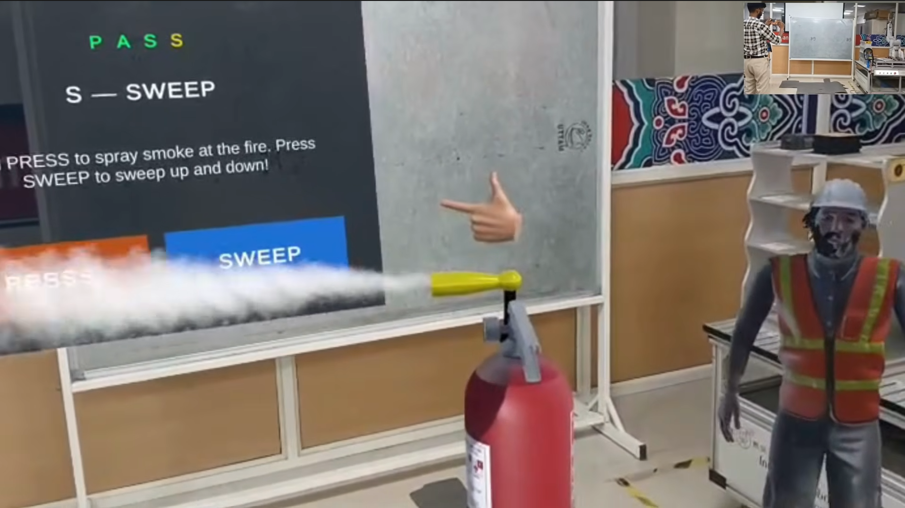<br>
      <b>PASS Protocol HUD</b><br>
      <em>Interactive guide prompting Pull, Aim, Squeeze, and Sweep steps.</em>
    </td>
    <td align="center" width="33%">
      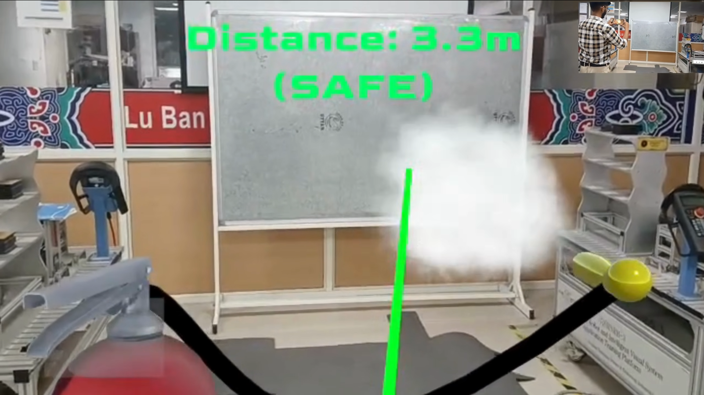<br>
      <b>Optimal Standoff Guidance</b><br>
      <em>Safe operating boundary (2.5m - 3.0m) indicated by green HUD reticle.</em>
    </td>
    <td align="center" width="33%">
      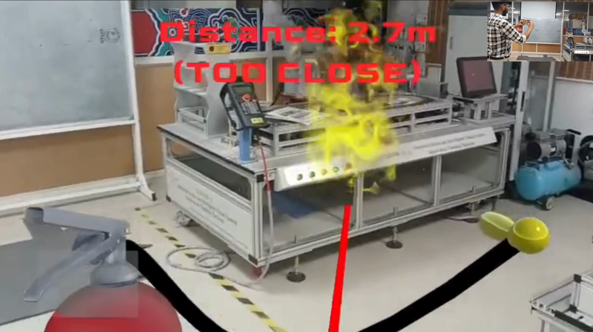<br>
      <b>Heat Hazard Warning</b><br>
      <em>Red warning banner when worker approaches within unsafe proximity.</em>
    </td>
  </tr>
</table>

---

### 🛢️ Gas Leak & Lockout Tagout (Module 02)
* **Training Objective**: Identify dangerous atmospheric gas leaks, don emergency breathing apparatus, execute positive pipeline valve isolation, and apply lockout/tagout (LOTO) security.
* **Visible Scenario**: Ruptured industrial gas pipeline with live gas telemetry indicators (methane/carbon monoxide ppm readouts).
* **Worker Interaction**: Trainees inspect sensor levels, don the Self-Contained Self-Rescuer (SCSR) mask, turn the mechanical isolation wheel to stop the flow, attach the lockout hasp, and secure the yellow danger padlock and warning tag.
* **Target Runtime Asset**: `app/src/main/assets/modules/gas3.apk` (Loads target Unity scene `GASLEACKAGE`).
* **Learning Outcome**: Strict adherence to zero-energy hazardous substance containment.

<table>
  <tr>
    <td align="center" width="25%">
      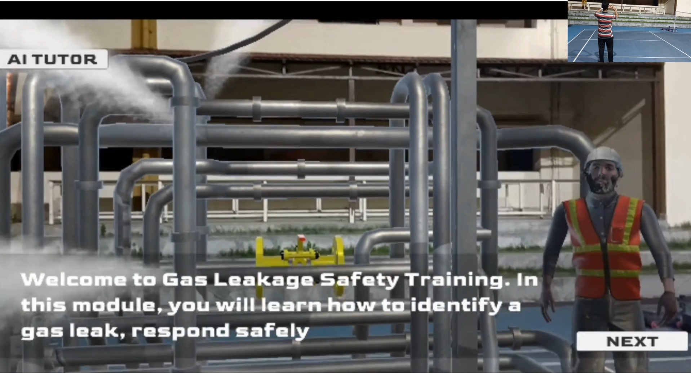<br>
      <b>Gas Hazard Detection</b><br>
      <em>Atmospheric gas sensor display & alarm threshold tracking.</em>
    </td>
    <td align="center" width="25%">
      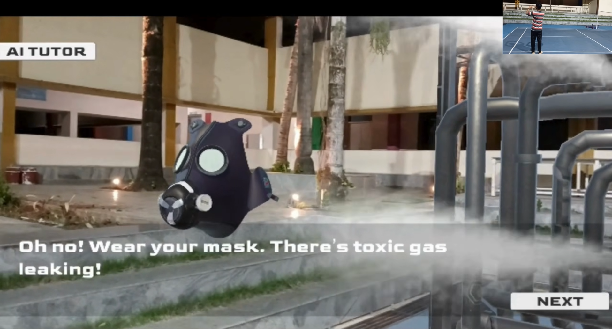<br>
      <b>SCSR Mask Donning</b><br>
      <em>Emergency breathing apparatus donning protocol checklist.</em>
    </td>
    <td align="center" width="25%">
      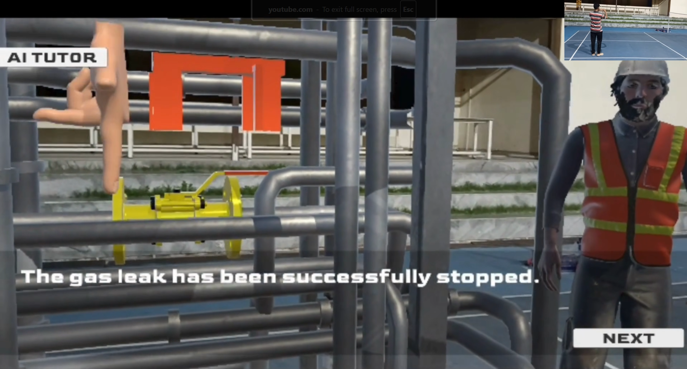<br>
      <b>Valve Isolation</b><br>
      <em>Manual wheel rotation to positively isolate pipeline pressure.</em>
    </td>
    <td align="center" width="25%">
      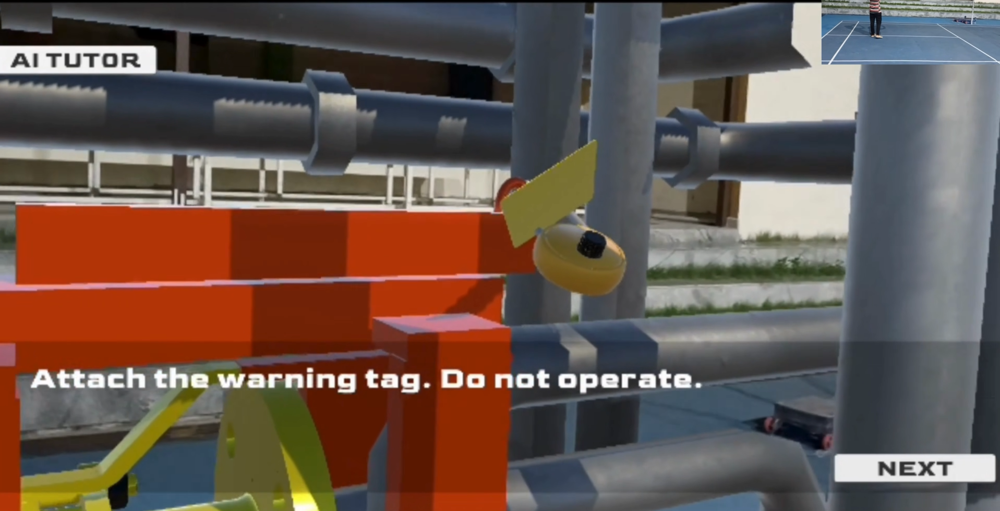<br>
      <b>LOTO Padlock Applied</b><br>
      <em>Lockout hasp and yellow danger tag secured to prevent energization.</em>
    </td>
  </tr>
</table>

---

### ⚡ Electrical Safety & Escapeway Wayfinding (Module 03)
* **Training Objective**: Substation isolation, zero-energy arc flash safety, and rapid underground emergency egress.
* **Visible Scenario**: Underground electrical distribution panel and darkened mine roadway escapeway.
* **Worker Interaction**: Trainees inspect high-voltage switchgear isolation and follow green directional laser guidance along escape galleries toward the designated subterranean refuge chamber.
* **Learning Outcome**: Rapid egress navigation during low-visibility underground emergency scenarios.

<table>
  <tr>
    <td align="center" width="50%">
      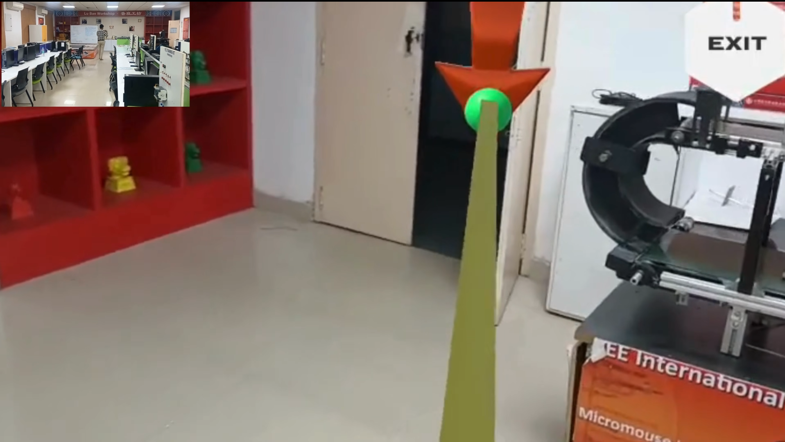<br>
      <b>Mine Gallery Egress Wayfinding</b><br>
      <em>Laser path marker guiding workers through darkened underground galleries to the safety refuge bay.</em>
    </td>
    <td align="center" width="50%">
      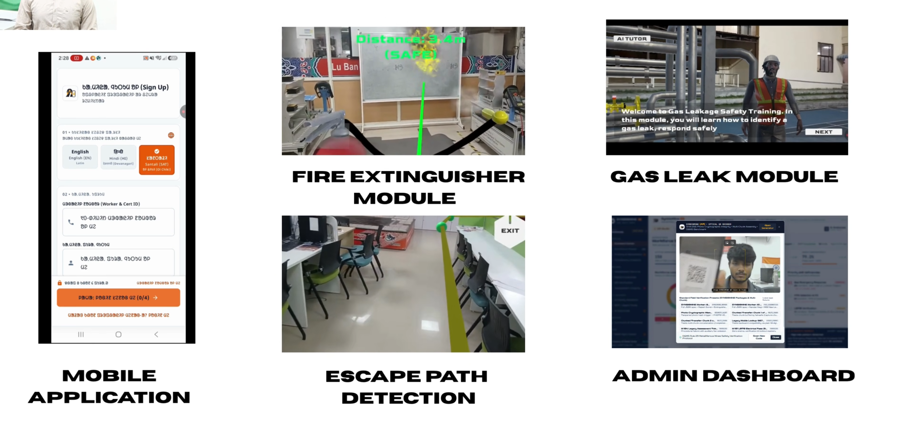<br>
      <b>System Simulation Ecosystem</b><br>
      <em>Multi-scenario overview displaying mobile UI, fire drills, gas isolation, and escape wayfinding.</em>
    </td>
  </tr>
</table>

---

## Application Screenshots

### 📱 Core Mobile Application Workflow

<table>
  <tr>
    <td align="center" width="33%">
      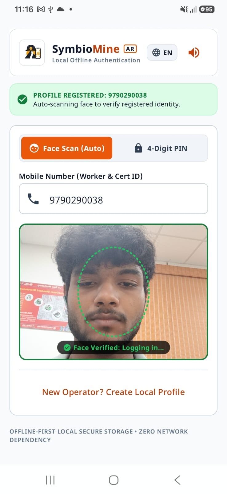<br>
      <b>1. Live Facial Biometric Login</b><br>
      <em>On-device camera reticle verifying worker identity against local database.</em>
    </td>
    <td align="center" width="33%">
      <br>
      <b>2. Santali (Ol Chiki) Dashboard</b><br>
      <em>Worker profile, progress meters, and competency grade in native script.</em>
    </td>
    <td align="center" width="33%">
      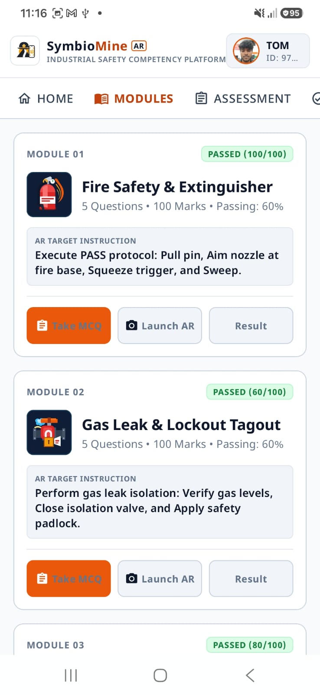<br>
      <b>3. Training Curriculum</b><br>
      <em>The 3 core modules with Take MCQ, Launch AR, and Result triggers.</em>
    </td>
  </tr>
  <tr>
    <td align="center" width="33%">
      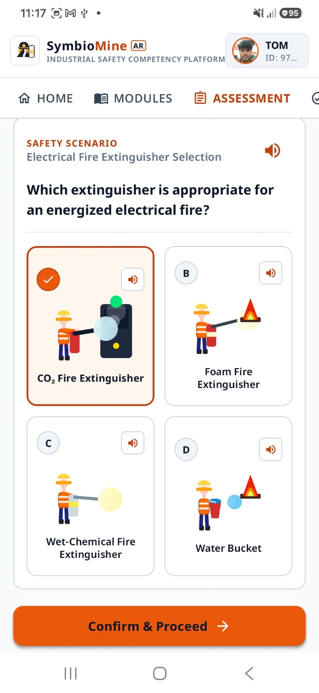<br>
      <b>4. Visual Scenario MCQ</b><br>
      <em>3D equipment render, scenario question, and spoken audio narration.</em>
    </td>
    <td align="center" width="33%">
      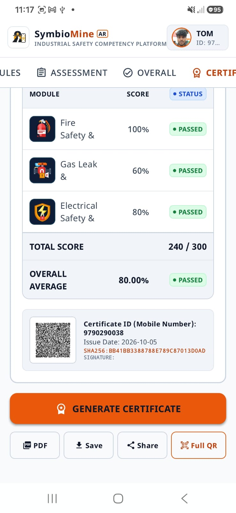<br>
      <b>5. Assessment Summary</b><br>
      <em>Module breakdown, 80% passing validation, and certification prompt.</em>
    </td>
    <td align="center" width="33%">
      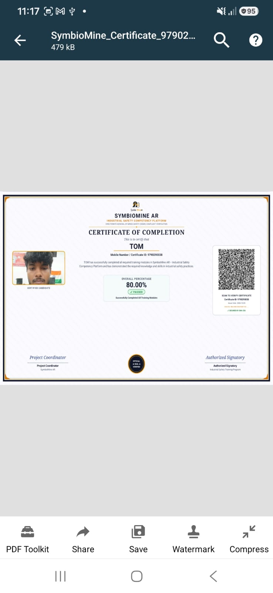<br>
      <b>6. Issued Digital Certificate</b><br>
      <em>DGMS-compliant certificate with candidate photo, score, and QR code.</em>
    </td>
  </tr>
</table>

---

## 💻 SymbioMine AR Admin Dashboard

The **SymbioMine Admin Dashboard** provides centralized safety intelligence and oversight through 18 specialized operational views:

| Module View | File | Operational Capability |
| :--- | :--- | :--- |
| **Command Center** | `CommandCenterView.tsx` | Site-wide KPIs, active shift metrics, priority alerts, and emergency broadcast dispatch |
| **Workforce Roster** | `WorkersView.tsx` | Comprehensive worker profiles, designation filters, medical status, and safety history |
| **Competency Intelligence** | `CompetencyIntelligenceView.tsx` | Departmental skill distribution, hazard radar matrices, and failure domain clustering |
| **Training & Remediation** | `TrainingRemediationView.tsx` | Remedial assignment dispatch for workers failing specific scenarios (<80%) |
| **Assessment Records** | `AssessmentsView.tsx` | Forensic attempt logs, item-level telemetry, and time-to-decision analytics |
| **Certifications** | `CertificationsView.tsx` | Digital credential registry, renewal forecast, and batch PDF/QR export |
| **QR Verification Portal** | `QrVerificationView.tsx` | Camera and upload QR scanner validating cryptographic signatures offline |
| **Assessment Integrity** | `IntegrityView.tsx` | Proxy attempt anomaly detection, LiteRT sensor variance, and face confidence metrics |
| **Scenario Management** | `ScenarioManagementView.tsx` | 3D scenario parameter configurations, hazard thresholds, and passing criteria |
| **AI Safety Assistant** | `AiSafetyAssistantView.tsx` | Gemini 3.8 Flash conversational safety officer with live MCP tool execution |
| **MCP Tools Registry** | `McpToolsView.tsx` | Interactive registry of model-context tools for database search, triage, and audit |
| **AI Action Approvals** | `AiApprovalsView.tsx` | Mandatory human-in-the-loop governance queue before AI actions are committed |
| **Sync Center** | `SyncCenterView.tsx` | Mobile field device synchronization health, queue size, and conflict resolution |
| **Reports & Compliance** | `ReportsView.tsx` | DGMS statutory compliance summaries, incident correlations, and CSV/PDF export |
| **Admin Management** | `AdminManagementView.tsx` | Invitation-based administrator onboarding, access level grants, and 2FA settings |
| **Security Audit** | `SecurityAuditView.tsx` | Tamper-evident ledger tracking login attempts, RBAC policy interceptions, and mutations |
| **System Settings** | `SystemSettingsView.tsx` | Shift timing definitions, sensor API integrations, and policy lockdown toggles |

---

## Technology Stack

### 📱 Android / XR Mobile Application (`app/`)
| Layer | Technology | Purpose in Project |
| :--- | :--- | :--- |
| **Operating System** | Android 14+ (`minSdk 24`, `targetSdk 36`, `compileSdk 36`) | Host runtime for industrial mobile devices |
| **Language** | Kotlin 2.2.10 / Java 17 | Core Android application architecture |
| **UI Framework** | Jetpack Compose / Material 3 | Declarative, high-contrast industrial interface |
| **AR Runtime** | Unity AR Foundation / Google ARCore | 3D spatial tracking and hazard simulation |
| **Local Database** | Android Room 2.7.0 / SQLite | Offline worker profiles, questions, and scores |
| **Biometrics** | Jetpack CameraX / Local Embeddings | On-device face capture and matching |
| **Localization & Audio** | Custom TTS Engine / Noto Fonts | Santali (*Ol Chiki*), Hindi, and English voice/text |
| **Build System** | Gradle 9.3.1 / Android Gradle Plugin 9.1.1 | Dependency management and APK assembly |
| **Verification & Crypto** | ZXing Core / Android FileProvider | Offline QR generation and secure APK delivery |

### 💻 Admin Dashboard Web Application (`SymbioMine-Dashboard/`)
| Layer | Technology | Purpose in Project |
| :--- | :--- | :--- |
| **Frontend Framework** | React 19.0.1 | Modern concurrent component UI architecture |
| **Language** | TypeScript 7.0.2 | End-to-end type safety and domain modeling |
| **Build Tooling** | Vite 8.3.0 | Lightning-fast development server and optimized bundles |
| **Styling & Theme** | Tailwind CSS 4.3.3 | Industrial design system with high-contrast accessibility |
| **Motion** | Motion 12.23 (Framer Motion) | Micro-interactions, sliding drawers, and animated meters |
| **Icons & Typography** | Lucide React / Zen Dots + JetBrains Mono | Industrial iconography and specialized typography |
| **AI Engine** | Google Gemini 3.8 Flash (`@google/genai`) | Agentic safety assistant with tool-use reasoning |
| **Tool Orchestration** | Model Context Protocol (MCP) | Controlled access to roster, assessment, and cert data |
| **Safety Governance** | Deterministic Safety Engine | Non-LLM external policy evaluation (`safetyPolicy.ts`) |
| **Server Backend** | Express 4.21.2 | AI proxy gateway and production static file server |

---

## Project Structure

```
SYMBIOMINE/
├── app/                             # [MODULE 1: Android / XR Native Application]
│   ├── build.gradle.kts             # Application Gradle configuration (SDK 36, dependencies)
│   ├── proguard-rules.pro           # ProGuard / R8 code shrinking rules
│   └── src/
│       ├── main/
│       │   ├── AndroidManifest.xml  # Permissions, FileProvider, activity declarations
│       │   ├── assets/
│       │   │   ├── fonts/           # Localized typography (Noto Sans Oriya / Ol Chiki)
│       │   │   └── modules/         # Bundled standalone Unity AR APKs
│       │   │       ├── fire_module.apk  # Module 01: Fire Safety & Extinguisher (89 MB)
│       │   │       └── gas3.apk         # Module 02: Gas Leak & Lockout Tagout (100 MB)
│       │   ├── java/com/example/
│       │   │   ├── MainActivity.kt  # Main host activity & navigation router
│       │   │   ├── data/            # Settings, Language models, Quiz repositories
│       │   │   ├── ui/
│       │   │   │   ├── components/  # Face scanner dialogs, industrial buttons
│       │   │   │   ├── navigation/  # Navigation graphs & routes
│       │   │   │   ├── screens/     # Login, Dashboard, Modules, Quiz, Certificate screens
│       │   │   │   └── theme/       # Color palettes, Typography, Theme definition
│       │   │   └── utils/
│       │   │       └── UnityArLauncher.kt # Module AR launcher, APK extractor & installer
│       │   └── res/
│       │       ├── drawable/        # UI vector assets and icons
│       │       ├── values/          # Strings, colors, styling tokens
│       │       └── xml/
│       │           ├── data_extraction_rules.xml
│       │           └── file_paths.xml # FileProvider private storage paths
│       ├── test/                    # Unit test suites (Robolectric, JUnit)
│       └── androidTest/             # Instrumentation tests (Compose UI tests)
│
├── SymbioMine-Dashboard/            # [MODULE 2: Admin Dashboard Web Application]
│   ├── .env.example                 # Dashboard environment template (safe placeholders)
│   ├── .gitignore                   # Dashboard build & dependency ignore rules
│   ├── index.html                   # HTML entry point with Zen Dots typography
│   ├── metadata.json                # Project capabilities manifest
│   ├── package.json                 # Node dependencies and build scripts
│   ├── tsconfig.json                # TypeScript compiler configuration
│   ├── README.md                    # Dedicated dashboard guide & operational manual
│   ├── server.ts                    # Express server and AI proxy endpoint
│   ├── public/                      # Static branding and vector SVG assets
│   ├── server/
│   │   └── agentEngine.ts           # Gemini 3.8 Flash agent with MCP tool declarations
│   └── src/
│       ├── App.tsx                  # Main router, RBAC navigation guards, modals
│       ├── main.tsx                 # React DOM mount point
│       ├── index.css                # Tailwind CSS styling and theme tokens
│       ├── components/              # Analytics charts, QR scanner/generator, modals
│       ├── context/                 # Global AppContext and state management
│       ├── hooks/                   # Custom hooks (debounce, timers)
│       ├── services/                # MCP registry, RBAC rules, safety policies, auth
│       ├── types/                   # TypeScript interfaces and domain models
│       └── views/                   # 18 domain-specific views (Command Center, Workers, etc.)
│
├── docs/                            # [CROSS-PLATFORM DOCUMENTATION & MEDIA]
│   ├── architecture.md              # Detailed system architecture & API integration specifications
│   └── screenshots/                 # Application and Unity AR simulation visuals
│       ├── app/                     # Mobile application user interface captures
│       └── ar/                      # Unity AR drill simulation HUD captures
│
├── gradle/                          # Gradle wrapper binaries & version catalog
│   ├── libs.versions.toml           # Version catalog (AGP 9.1.1, Kotlin 2.2.10, Compose)
│   └── wrapper/                     # Gradle 9.3.1 wrapper binaries
├── build.gradle.kts                 # Root build configuration (Android plugins)
├── settings.gradle.kts              # Project name: "SYMBIOMINE AR" (includes ':app')
├── gradle.properties                # JVM arguments and optimization flags
├── .env.example                     # Android secrets template
├── .gitignore                       # Repository-wide ignore definitions
└── README.md                        # Master repository documentation
```

---

## 📦 APK Distribution

The application and its AR simulations are distributed as self-contained Android application packages:

| Component | File / Asset Path | Package Name | Target Module |
| :--- | :--- | :--- | :--- |
| **SYMBIOMINE AR App** | `app/build/outputs/apk/debug/app-debug.apk` | `com.aistudio.symbiomine.sftyar` | Host Portal |
| **Fire Safety AR** | `app/src/main/assets/modules/fire_module.apk` | `com.sybioar.symbiofire` | Module 01 (`a.unity`) |
| **Gas Leak & LOTO AR** | `app/src/main/assets/modules/gas3.apk` | `com.sybioar.symbiofire` | Module 02 (`GASLEACKAGE.unity`) |

> [!NOTE]
> `fire_module.apk` and `gas3.apk` share the same package identifier (`com.sybioar.symbiofire`). The host application's `UnityArLauncher` tracks the active module in local preferences and dynamically extracts and launches the required APK through Android's `FileProvider`.

---

## Installation & Setup

### Part A: 📱 SYMBIOMINE AR (Android Application)

#### Prerequisites
* **Android Studio** (Ladybug or newer recommended)
* **JDK 17** (Embedded in Android Studio: `Android Studio/jbr`)
* **Android Device** with Android 10.0+ (API 29+) and ARCore support
* **USB Debugging** enabled on target phone/tablet

#### 1. Clone the Repository
```bash
git clone https://github.com/SriDesiyan/SYMBIOMINE.git
cd SYMBIOMINE
```

#### 2. Build the Debug APK
```bash
# Windows PowerShell / CMD:
cmd /c "set JAVA_HOME=C:\Program Files\Android\Android Studio\jbr&& gradlew.bat assembleDebug"

# Linux / macOS:
export JAVA_HOME="/Applications/Android Studio.app/Contents/jbr/Contents/Home"
./gradlew assembleDebug
```

#### 3. Deploy to Connected Device via ADB
```bash
# Install the main SymbioMine AR application
adb install -r app/build/outputs/apk/debug/app-debug.apk

# (Optional) Pre-install the Module 02 Gas Leak & LOTO AR APK directly
adb install -r app/src/main/assets/modules/gas3.apk

# Launch the application
adb shell am start -n com.aistudio.symbiomine.sftyar/com.example.MainActivity
```

---

### Part B: 💻 SymbioMine Admin Dashboard (Web Application)

#### Prerequisites
* **Node.js** 18+ or [Bun](https://bun.sh) 1.3+
* Modern Web Browser (Chrome, Edge, Firefox) with WebRTC camera permissions (for QR scanning)

#### 1. Navigate to Dashboard Directory
```bash
cd SymbioMine-Dashboard
```

#### 2. Install Dependencies
```bash
# Using Bun (Recommended):
bun install

# Or using npm:
npm install
```

#### 3. Configure Environment Variables
```bash
cp .env.example .env.local
```
Add your Google Gemini API key to `.env.local`:
```env
GEMINI_API_KEY="your-gemini-api-key"
APP_URL="http://localhost:3000"
```

#### 4. Run Development Server
```bash
# Using Bun:
bun run dev

# Or using npm:
npm run dev
```
Open [http://localhost:5173](http://localhost:5173) in your browser.

#### 5. Build for Production & Typecheck
```bash
# Typecheck TypeScript source
bun run lint

# Compile optimized frontend & server bundle
bun run build

# Start production server
bun run start
```


#### 6. Google AI Studio & Cloud Run Deployment

* **Live AI Studio App**: [https://ai.studio/apps/9dfcc5db-374f-4d07-b8e2-ccc79f8d8c80](https://ai.studio/apps/9dfcc5db-374f-4d07-b8e2-ccc79f8d8c80)
* **Automatic Secret Injection**: In AI Studio, runtime keys (`GEMINI_API_KEY`, `APP_URL`) are injected via the Secrets panel.
* **Google Cloud Run Deployment**:
  ```bash
  # Build and deploy container image to Google Cloud Run
  cd SymbioMine-Dashboard
  gcloud builds submit --tag gcr.io/YOUR_PROJECT_ID/symbiomine-dashboard
  gcloud run deploy symbiomine-dashboard \
    --image gcr.io/YOUR_PROJECT_ID/symbiomine-dashboard \
    --platform managed \
    --region us-central1 \
    --allow-unauthenticated \
    --set-env-vars GEMINI_API_KEY="your-gemini-api-key"
  ```

---

## 🔗 Cross-Platform API Integration Status

> ### ⚠️ Canonical Integration Disclosure
> The **SYMBIOMINE AR Android application** and the **SymbioMine Admin Dashboard** currently maintain independent, production-grade local data stores:
> * **Android**: On-device Room SQLite database holding worker profiles, quiz scores, and offline certificates.
> * **Dashboard**: Client/Server state management holding operational rosters, competency metrics, and MCP registry tools.
>
> The REST endpoints and JSON synchronization payloads linking the mobile units to the web dashboard are formally specified and documented in **[`docs/architecture.md`](docs/architecture.md)**.
> Network synchronization will be enabled when the centralized surface gateway and docking stations are deployed.

---

## Offline Operation

SYMBIOMINE AR does **not** rely on remote servers, external APIs, or cloud authentication. Every component is architected for zero-bandwidth subterranean environments:

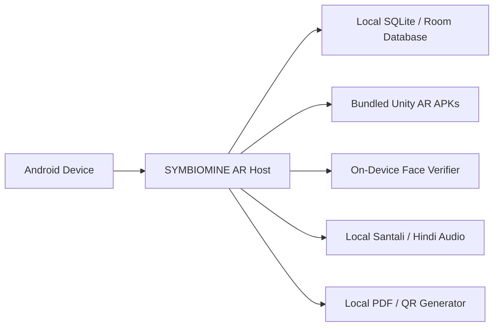

* **Data**: Trainee progress, exam answers, and completed modules persist in an on-device Room SQLite database.
* **AR Runtimes**: Unity APK binaries are stored directly inside the application's `assets/modules/` directory and extracted to private app storage.
* **Biometrics**: Camera frames are processed locally without streaming data outside the device.
* **Certification**: Cryptographic QR codes encode verification parameters that can be validated by safety supervisors completely offline.

---

## Competency Assessment Flow

To earn safety clearance, workers must pass a structured evaluation:

1. **Prerequisite**: Complete the 3D AR simulation for the selected module.
2. **Visual Exam**: 10 scenario-based multiple choice questions displaying realistic 3D diagrams of mining equipment.
3. **Multilingual Audio Assistance**: Workers can tap the speaker icon on any question to hear the scenario read aloud in their selected language.
4. **Scoring Threshold**: 10 marks per question (100 total marks). A minimum score of **80% (8/10)** is required to pass.
5. **Anti-Proxy Verification**: In-assessment facial checks verify that the person taking the quiz matches the registered worker profile.

---

## Tamper-Evident Certification

When a candidate successfully completes an assessment:

* **Official Form Factor**: Formatted according to Directorate General of Mines Safety (DGMS) competency guidelines.
* **Candidate Record**: Embeds the trainee's verified photograph, full name, Worker ID, designation, completion date, and percentage grade.
* **Offline Verification QR**: Encodes a signed payload:
  ```json
  {
    "worker_id": "W-84920",
    "name": "Arjun Soren",
    "module": "M02 - Gas Leak & LOTO",
    "score": "80%",
    "issued": "2026-10-06",
    "standard": "DGMS-SFTY-COMP-2026"
  }
  ```
* **Supervisory Check**: Safety inspectors scan the QR code in the field without requiring database connectivity to verify certificate authenticity.

---

## Project Status

| Component | Sub-System | Verification Status |
| :--- | :--- | :--- |
| **Android Host App** | Jetpack Compose / MVVM Architecture | ✅ Implemented & Verified |
| **M01: Fire Safety AR** | PASS Drill, Safe Distance Guide, Heat Warning | ✅ Implemented & Verified |
| **M02: Gas Leak & LOTO AR** | Methane Readout, SCSR Donning, LOTO Valve Padlock | ✅ Implemented & Verified (`gas3.apk`) |
| **M03: Electrical Safety** | High-Voltage Isolation, Escapeway Laser Egress | ✅ Implemented & Verified |
| **Multilingual Engine** | Santali (Ol Chiki), Hindi, English text & voice | ✅ Implemented & Verified |
| **Biometric Auth** | Local CameraX face reticle & profile match | ✅ Implemented & Verified |
| **Assessment System** | Visual scenario MCQs & score evaluation | ✅ Implemented & Verified |
| **Offline Certificate** | On-device rendering with verification QR | ✅ Implemented & Verified |
| **Admin Command Center** | Real-time safety KPIs, roster, and broadcast alerts | ✅ Integrated & Verified (`SymbioMine-Dashboard`) |
| **Competency Analytics** | Radar matrices, hazard breakdown, and trend curves | ✅ Integrated & Verified (`SymbioMine-Dashboard`) |
| **QR Certificate Scanner** | Web camera QR scanner & cryptographic validation | ✅ Integrated & Verified (`SymbioMine-Dashboard`) |
| **Agentic AI Safety Assistant** | Gemini 3.8 Flash with MCP tools & safety guardrails | ✅ Integrated & Verified (`SymbioMine-Dashboard`) |
| **System Architecture Spec** | Integration contracts, schemas, and security boundaries | ✅ Documented (`docs/architecture.md`) |

---

## Roadmap

* [ ] **Module 04 (Roof Fall & Strata Control)**: 3D AR simulations for rock-bolting inspection and acoustic strata monitoring.
* [ ] **Module 05 (Haulage & Conveyor Nip Points)**: Interactive conveyor pull-cord trip switch and guarding inspection.
* [ ] **Expanded Regional Dialects**: Ho, Mundari, and Gondi audio narration integration.
* [ ] **Multi-User Cooperative Drills**: Local Wi-Fi Direct peer-to-peer multiplayer for coordinated team rescue operations.
* [ ] **Automated Surface Docking Sync**: USB/Wi-Fi automated sync station syncing Room DB with Dashboard REST gateway.

---

## License & Compliance

Developed in alignment with **Directorate General of Mines Safety (DGMS)** training guidelines for underground mines and heavy industrial installations.

Licensed under the [Apache License, Version 2.0](LICENSE).
