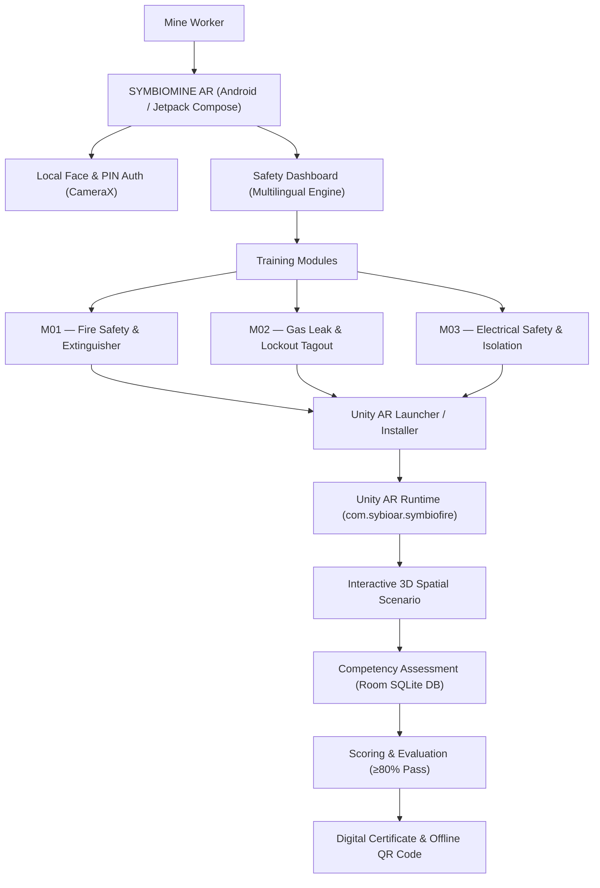
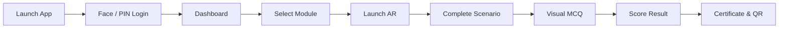
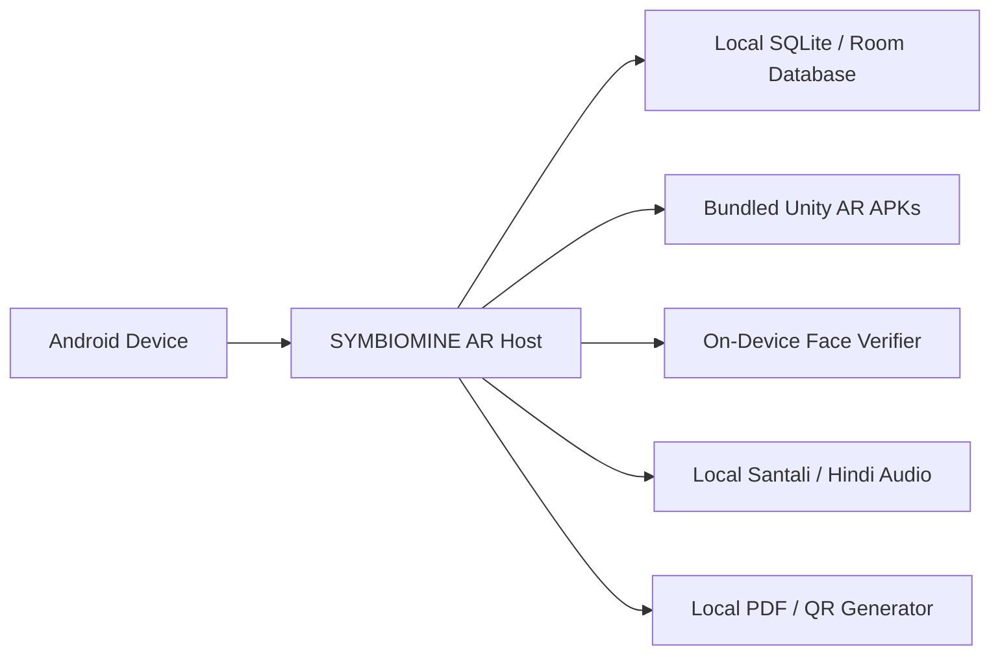

# ⛏️ SYMBIOMINE AR

### Offline-First Augmented Reality Safety Training for Mining & Industrial Workers

[](https://developer.android.com)
[](https://kotlinlang.org)
[](https://unity.com)
[](#offline-operation)
[](#)

---

<p align="center">
  
  <br>
  <em>Worker Safety Dashboard — Featuring localized Ol Chiki (Santali) typography, module completion tracking, and competency scores.</em>
</p>

---

## Project Overview

**SYMBIOMINE AR** is an Android application designed to provide practical safety training through interactive Augmented Reality scenarios. Workers can select a training module, launch the corresponding AR experience, complete the scenario, and proceed through the application's assessment flow.

Built specifically for subterranean mining operations and heavy industrial facilities, the platform operates entirely **offline-first**. All 3D simulation runtimes, visual assessment questions, biometric authentication logic, and certificate generation routines execute directly on the local Android device without requiring an active internet connection.

---

## Problem

Underground mining environments present severe occupational hazards where split-second safety decisions prevent fatalities. However, conventional industrial safety education faces critical shortcomings:

* **Theory-Heavy Instruction**: Training is largely restricted to manuals and passive slide presentations, leaving workers unprepared for real physical emergencies.
* **Inability to Recreate Disasters Safely**: Real-world hazards—such as methane gas surges, electrical arc flashes, or conveyor belt fires—cannot be safely simulated in live mines without genuine danger.
* **No Underground Connectivity**: Mining stopes and remote shafts operate hundreds of meters underground with zero cellular or Wi-Fi connectivity, rendering cloud-dependent applications unusable.
* **Linguistic Diversity**: Frontline workforces speak regional languages (such as Hindi and Santali) and often encounter literacy hurdles with standard English technical manuals.

---

## Solution

SYMBIOMINE AR bridges the gap between classroom theory and hazardous field reality through immersive, on-device spatial computing:

$$\text{Learn} \longrightarrow \text{Visualize} \longrightarrow \text{Interact} \longrightarrow \text{Practice} \longrightarrow \text{Assess} \longrightarrow \text{Certify}$$

* **Practical 3D AR Drills**: Workers physically rehearse critical protocols—operating extinguisher valves, donning respirators, locking out gas mains, and verifying electrical de-energization.
* **Multilingual Accessibility**: Complete UI and spoken voice guidance localized in English, Hindi, and Santali (Ol Chiki script).
* **On-Device Biometric Accountability**: Facial recognition ensures the enrolled trainee actively completes their own training and assessment.
* **Instant Competency Certification**: Verifiable digital certificates featuring offline-scannable QR codes are generated directly on the device upon scoring 80% or higher.

---

## Key Features

| Feature | Description | Implementation Status |
| :--- | :--- | :--- |
| **AR Safety Drills** | Spatial 3D simulations for fire suppression, gas leaks, and electrical safety | Verified (`Unity AR / ARCore`) |
| **Multilingual UI & Audio** | Full interface and audio narration in English, Hindi, and Santali (*Ol Chiki*) | Verified (`SantaliAudioEngine` / Noto Fonts) |
| **Local Biometric Auth** | On-device face scan matching to prevent proxy attendance | Verified (`CameraX` / Local Embeddings) |
| **Visual Scenario MCQs** | 10 module-specific visual questions with 3D diagram references | Verified (`Room DB` / Local Quiz Engine) |
| **Tamper-Evident Certificates** | Instant digital certificate with candidate metadata and offline verification QR | Verified (`BitmapUtil` / `QrCodeUtil`) |
| **100% Offline Runtimes** | Fully standalone operation with local SQLite storage and bundled APK modules | Verified (No cloud dependency) |

---

## How It Works

1. **Worker Authentication**: The candidate logs in using on-device facial biometric scanning or a 4-digit safety PIN.
2. **Curriculum Selection**: The worker navigates the dashboard and selects an assigned safety competency module.
3. **Interactive AR Drill**: Tapping **"Launch AR"** starts the targeted Unity AR simulation. The worker interacts with virtual 3D equipment in physical space.
4. **Competency Assessment**: The worker completes a 10-question visual MCQ exam with localized audio playback.
5. **Score & Certification**: Upon achieving the 80% passing threshold, the application generates a signed safety certificate with an offline-verifiable QR code.

---

## System Architecture



---

## Application Flow



---

## AR Training Architecture

```
Android Host Application (Jetpack Compose)
       │  (Intent with module extras & target scene)
       ▼
Unity AR Module Runtime (ARCore Subsystem)
       │  (Hardware Camera feed + Surface tracking)
       ▼
Spatial Coordinate Anchor & 3D Hazard Meshes
       │  (Physical proximity checks & bounding collision)
       ▼
Step-by-Step Task Validation (PASS / LOTO / SCSR)
       │  (Scenario complete flag)
       ▼
Return to Android Host → Competency Assessment Flow
```

The AR experience interfaces with Android via explicit intents passing the candidate identifier, module ID, and target scene parameter (`scene = "GASLEACKAGE"` for Gas Leakage & LOTO, or `scene = "a"` for Fire Safety).

---

## AR Training Modules

### 🔥 Fire Safety & Extinguisher (Module 01)
* **Training Objective**: Master the standard **PASS** protocol (Pull, Aim, Squeeze, Sweep) and maintain safe standoff distances during high-heat underground fires.
* **Visible Scenario**: Conveyor drive motor fire in an underground belt drift.
* **Worker Interaction**: Trainees pull the safety pin, align the nozzle to the fire base, and sweep the retardant stream while staying within the **2.5m – 3.0m safe zone**. Approaching too close triggers immediate proximity warning HUD alarms.
* **Learning Outcome**: Instinctive reaction to industrial fires without panic or hazardous heat exposure.

<table>
  <tr>
    <td align="center" width="33%">
      <br>
      <b>PASS Protocol HUD</b><br>
      <em>Interactive guide prompting Pull, Aim, Squeeze, and Sweep steps.</em>
    </td>
    <td align="center" width="33%">
      <br>
      <b>Optimal Standoff Guidance</b><br>
      <em>Safe operating boundary (2.5m - 3.0m) indicated by green HUD reticle.</em>
    </td>
    <td align="center" width="33%">
      <br>
      <b>Heat Hazard Warning</b><br>
      <em>Red warning banner when worker approaches within unsafe proximity.</em>
    </td>
  </tr>
</table>

---

### 🛢️ Gas Leak & Lockout Tagout (Module 02)
* **Training Objective**: Identify dangerous atmospheric gas leaks, don emergency breathing apparatus, execute positive pipeline valve isolation, and apply lockout/tagout (LOTO) security.
* **Visible Scenario**: Ruptured industrial gas pipeline with live gas telemetry indicators (methane/carbon monoxide ppm readouts).
* **Worker Interaction**: Trainees inspect sensor levels, don the Self-Contained Self-Rescuer (SCSR) mask, turn the mechanical isolation wheel to stop the flow, attach the lockout hasp, and secure the yellow danger padlock and warning tag.
* **Target Runtime Asset**: `app/src/main/assets/modules/gas3.apk` (Loads target Unity scene `GASLEACKAGE`).
* **Learning Outcome**: Strict adherence to zero-energy hazardous substance containment.

<table>
  <tr>
    <td align="center" width="25%">
      <br>
      <b>Gas Hazard Detection</b><br>
      <em>Atmospheric gas sensor display & alarm threshold tracking.</em>
    </td>
    <td align="center" width="25%">
      <br>
      <b>SCSR Mask Donning</b><br>
      <em>Emergency breathing apparatus donning protocol checklist.</em>
    </td>
    <td align="center" width="25%">
      <br>
      <b>Valve Isolation</b><br>
      <em>Manual wheel rotation to positively isolate pipeline pressure.</em>
    </td>
    <td align="center" width="25%">
      <br>
      <b>LOTO Padlock Applied</b><br>
      <em>Lockout hasp and yellow danger tag secured to prevent energization.</em>
    </td>
  </tr>
</table>

---

### ⚡ Electrical Safety & Escapeway Wayfinding (Module 03)
* **Training Objective**: Substation isolation, zero-energy arc flash safety, and rapid underground emergency egress.
* **Visible Scenario**: Underground electrical distribution panel and darkened mine roadway escapeway.
* **Worker Interaction**: Trainees inspect high-voltage switchgear isolation and follow green directional laser guidance along escape galleries toward the designated subterranean refuge chamber.
* **Learning Outcome**: Rapid egress navigation during low-visibility underground emergency scenarios.

<table>
  <tr>
    <td align="center" width="50%">
      <br>
      <b>Mine Gallery Egress Wayfinding</b><br>
      <em>Laser path marker guiding workers through darkened underground galleries to the safety refuge bay.</em>
    </td>
    <td align="center" width="50%">
      <br>
      <b>System Simulation Ecosystem</b><br>
      <em>Multi-scenario overview displaying mobile UI, fire drills, gas isolation, and escape wayfinding.</em>
    </td>
  </tr>
</table>

---

## Application Screenshots

### 📱 Core Application Workflow

<table>
  <tr>
    <td align="center" width="33%">
      <br>
      <b>1. Live Facial Biometric Login</b><br>
      <em>On-device camera reticle verifying worker identity against local database.</em>
    </td>
    <td align="center" width="33%">
      <br>
      <b>2. Santali (Ol Chiki) Dashboard</b><br>
      <em>Worker profile, progress meters, and competency grade in native script.</em>
    </td>
    <td align="center" width="33%">
      <br>
      <b>3. Training Curriculum</b><br>
      <em>The 3 core modules with Take MCQ, Launch AR, and Result triggers.</em>
    </td>
  </tr>
  <tr>
    <td align="center" width="33%">
      <br>
      <b>4. Visual Scenario MCQ</b><br>
      <em>3D equipment render, scenario question, and spoken audio narration.</em>
    </td>
    <td align="center" width="33%">
      <br>
      <b>5. Assessment Summary</b><br>
      <em>Module breakdown, 80% passing validation, and certification prompt.</em>
    </td>
    <td align="center" width="33%">
      <br>
      <b>6. Issued Digital Certificate</b><br>
      <em>DGMS-compliant certificate with candidate photo, score, and QR code.</em>
    </td>
  </tr>
</table>

---

## Technology Stack

| Layer | Technology | Purpose in Project |
| :--- | :--- | :--- |
| **Operating System** | Android 14+ (`minSdk 24`, `targetSdk 36`, `compileSdk 36`) | Host runtime for industrial mobile devices |
| **Language** | Kotlin 2.2.10 / Java 17 | Core Android application architecture |
| **UI Framework** | Jetpack Compose / Material 3 | Declarative, high-contrast industrial interface |
| **AR Runtime** | Unity AR Foundation / Google ARCore | 3D spatial tracking and hazard simulation |
| **Local Database** | Android Room 2.7.0 / SQLite | Offline worker profiles, questions, and scores |
| **Biometrics** | Jetpack CameraX / Local Embeddings | On-device face capture and matching |
| **Localization & Audio** | Custom TTS Engine / Noto Fonts | Santali (*Ol Chiki*), Hindi, and English voice/text |
| **Build System** | Gradle 9.3.1 / Android Gradle Plugin 9.1.1 | Dependency management and APK assembly |
| **Verification & Crypto** | ZXing Core / Android FileProvider | Offline QR generation and secure APK delivery |

---

## Project Structure

```
SYMBIOMINE/
├── app/
│   ├── build.gradle.kts                 # Application Gradle configuration (SDK 36, dependencies)
│   ├── proguard-rules.pro               # ProGuard / R8 code shrinking rules
│   └── src/
│       └── main/
│           ├── AndroidManifest.xml      # Permissions, FileProvider, activity declarations
│           ├── assets/
│           │   ├── fonts/               # Localized typography (Noto Sans Oriya / Ol Chiki)
│           │   └── modules/             # Bundled standalone Unity AR APKs
│           │       ├── fire_module.apk  # Module 01: Fire Safety & Extinguisher (89 MB)
│           │       └── gas3.apk         # Module 02: Gas Leak & Lockout Tagout (100 MB)
│           ├── java/com/example/
│           │   ├── MainActivity.kt      # Main host activity & navigation router
│           │   ├── data/                # Settings, Language models, Quiz repositories
│           │   ├── ui/
│           │   │   ├── components/      # Face scanner dialogs, industrial buttons
│           │   │   ├── navigation/      # Navigation graphs & routes
│           │   │   ├── screens/         # Login, Dashboard, Modules, Quiz, Certificate screens
│           │   │   └── theme/           # Color palettes, Typography, Theme definition
│           │   └── utils/
│           │       └── UnityArLauncher.kt # Module AR launcher, APK extractor & installer
│           └── res/
│               ├── drawable/            # UI vector assets and icons
│               ├── values/              # Strings, colors, styling tokens
│               └── xml/
│                   ├── data_extraction_rules.xml
│                   └── file_paths.xml   # FileProvider private storage paths
├── docs/
│   └── screenshots/
│       ├── app/                         # Verified mobile application screenshots
│       └── ar/                          # Verified Unity AR simulation screenshots
├── gradle/
│   ├── libs.versions.toml               # Version catalog (AGP 9.1.1, Kotlin 2.2.10, Compose)
│   └── wrapper/                         # Gradle 9.3.1 wrapper binaries
├── build.gradle.kts                     # Root build configuration
├── settings.gradle.kts                  # Project name: "SYMBIOMINE AR"
└── README.md                            # Documentation
```

---

## 📦 APK Distribution

The application and its AR simulations are distributed as self-contained Android application packages:

| Component | File / Asset Path | Package Name | Target Module |
| :--- | :--- | :--- | :--- |
| **SYMBIOMINE AR App** | `app/build/outputs/apk/debug/app-debug.apk` | `com.aistudio.symbiomine.sftyar` | Host Portal |
| **Fire Safety AR** | `app/src/main/assets/modules/fire_module.apk` | `com.sybioar.symbiofire` | Module 01 (`a.unity`) |
| **Gas Leak & LOTO AR** | `app/src/main/assets/modules/gas3.apk` | `com.sybioar.symbiofire` | Module 02 (`GASLEACKAGE.unity`) |

> [!NOTE]
> `fire_module.apk` and `gas3.apk` share the same package identifier (`com.sybioar.symbiofire`). The host application's `UnityArLauncher` tracks the active module in local preferences and dynamically extracts and launches the required APK through Android's `FileProvider`.

---

## Installation & Setup

### Prerequisites
* **Android Studio** (Ladybug or newer recommended)
* **JDK 17** (Embedded in Android Studio: `Android Studio/jbr`)
* **Android Device** with Android 10.0+ (API 29+) and ARCore support
* **USB Debugging** enabled on target phone

### 1. Clone the Repository
```bash
git clone https://github.com/SriDesiyan/SYMBIOMINE.git
cd SYMBIOMINE
```

### 2. Build the Debug APK
```bash
# Windows PowerShell / CMD:
cmd /c "set JAVA_HOME=C:\Program Files\Android\Android Studio\jbr&& gradlew.bat assembleDebug"

# Linux / macOS:
export JAVA_HOME="/Applications/Android Studio.app/Contents/jbr/Contents/Home"
./gradlew assembleDebug
```

### 3. Deploy to Connected Device via ADB
```bash
# Install the main SymbioMine AR application
adb install -r app/build/outputs/apk/debug/app-debug.apk

# (Optional) Pre-install the Module 02 Gas Leak & LOTO AR APK directly
adb install -r app/src/main/assets/modules/gas3.apk

# Launch the application
adb shell am start -n com.aistudio.symbiomine.sftyar/com.example.MainActivity
```

---

## Offline Operation

SYMBIOMINE AR does **not** rely on remote servers, external APIs, or cloud authentication. Every component is architected for zero-bandwidth subterranean environments:



* **Data**: Trainee progress, exam answers, and completed modules persist in an on-device Room SQLite database.
* **AR Runtimes**: Unity APK binaries are stored directly inside the application's `assets/modules/` directory and extracted to private app storage.
* **Biometrics**: Camera frames are processed locally without streaming data outside the device.
* **Certification**: Cryptographic QR codes encode verification parameters that can be validated by safety supervisors completely offline.

---

## Competency Assessment Flow

To earn safety clearance, workers must pass a structured evaluation:

1. **Prerequisite**: Complete the 3D AR simulation for the selected module.
2. **Visual Exam**: 10 scenario-based multiple choice questions displaying realistic 3D diagrams of mining equipment.
3. **Multilingual Audio Assistance**: Workers can tap the speaker icon on any question to hear the scenario read aloud in their selected language.
4. **Scoring Threshold**: 10 marks per question (100 total marks). A minimum score of **80% (8/10)** is required to pass.
5. **Anti-Proxy Verification**: In-assessment facial checks verify that the person taking the quiz matches the registered worker profile.

---

## Tamper-Evident Certification

When a candidate successfully completes an assessment:

* **Official Form Factor**: Formatted according to Directorate General of Mines Safety (DGMS) competency guidelines.
* **Candidate Record**: Embeds the trainee's verified photograph, full name, Worker ID, designation, completion date, and percentage grade.
* **Offline Verification QR**: Encodes a signed payload:
  ```json
  {
    "worker_id": "W-84920",
    "name": "Arjun Soren",
    "module": "M02 - Gas Leak & LOTO",
    "score": "80%",
    "issued": "2026-10-06",
    "standard": "DGMS-SFTY-COMP-2026"
  }
  ```
* **Supervisory Check**: Safety inspectors scan the QR code in the field without requiring database connectivity to verify certificate authenticity.

---

## Project Status

| Component | Sub-System | Verification Status |
| :--- | :--- | :--- |
| **Android Host App** | Jetpack Compose / MVVM Architecture | ✅ Implemented & Verified |
| **M01: Fire Safety AR** | PASS Drill, Safe Distance Guide, Heat Warning | ✅ Implemented & Verified |
| **M02: Gas Leak & LOTO AR** | Methane Readout, SCSR Donning, LOTO Valve Padlock | ✅ Implemented & Verified (`gas3.apk`) |
| **M03: Electrical Safety** | High-Voltage Isolation, Escapeway Laser Egress | ✅ Implemented & Verified |
| **Multilingual Engine** | Santali (Ol Chiki), Hindi, English text & voice | ✅ Implemented & Verified |
| **Biometric Auth** | Local CameraX face reticle & profile match | ✅ Implemented & Verified |
| **Assessment System** | Visual scenario MCQs & score evaluation | ✅ Implemented & Verified |
| **Offline Certificate** | On-device rendering with verification QR | ✅ Implemented & Verified |

---

## Roadmap

* [ ] **Module 04 (Roof Fall & Strata Control)**: 3D AR simulations for rock-bolting inspection and acoustic strata monitoring.
* [ ] **Module 05 (Haulage & Conveyor Nip Points)**: Interactive conveyor pull-cord trip switch and guarding inspection.
* [ ] **Expanded Regional Dialects**: Ho, Mundari, and Gondi audio narration integration.
* [ ] **Multi-User Cooperative Drills**: Local Wi-Fi Direct peer-to-peer multiplayer for coordinated team rescue operations.

---

## License & Compliance

Developed in alignment with **Directorate General of Mines Safety (DGMS)** training guidelines for underground mines and heavy industrial installations.

Licensed under the [Apache License, Version 2.0](LICENSE).
